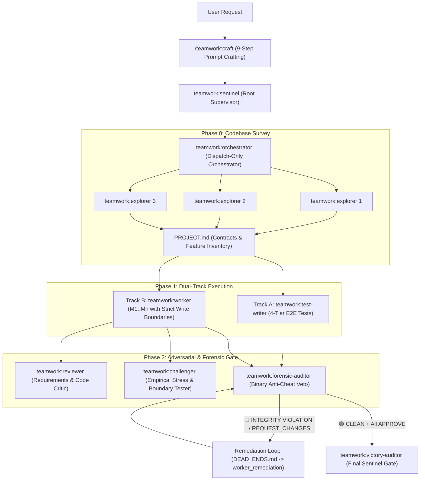

# Teamwork Plugin for Devin CLI

Autonomous multi-agent engineering system for **Devin CLI** featuring interactive 9-step prompt crafting, hierarchical multi-agent orchestration (`Sentinel -> Orchestrator -> Explorers, Test Writer, Milestone Workers`), Dual-Track 4-tier E2E testing, adversarial stress challengers, and binary forensic integrity auditing.

---

## Architecture Overview



---

## Installation in Devin CLI

### Install Directly from GitHub
```bash
devin plugins install matheuslessing/team-work-plugin
```

### Install from a Local Clone (Live Editing)
```bash
git clone https://github.com/matheuslessing/team-work-plugin.git
devin plugins install --local ./team-work-plugin
```

### Verify Installation
```bash
devin plugins list
devin plugins info teamwork
```

---

## Slash Commands (Skills)

| Command | Description |
| :--- | :--- |
| `/teamwork:craft` | Interactive 9-step prompt crafting workflow (`prompt_draft.md` $\to$ `ORIGINAL_REQUEST.md`) with automatic delegation. |
| `/teamwork:run` | Launch the full autonomous Teamwork Dual-Track pipeline (`Sentinel -> Orchestrator -> Survey -> Dual-Track -> Gate -> Victory Audit`). |
| `/teamwork:quick` | Run the **Small Focused Team** (`1 Worker + Adversarial Reviewer & Forensic Auditor loop`) for self-contained bug fixes or features. |
| `/teamwork:survey` | Run Phase 0 parallel read-only `teamwork:explorer` subagents to map the codebase and generate `PROJECT.md`. |
| `/teamwork:test-track` | Execute Track A (`teamwork:test-writer`) to author `TEST_INFRA.md`, 4-tier E2E test suites, an automated CLI runner, and `TEST_READY.md`. |
| `/teamwork:gate` | Run a Verification Gate (`reviewer` + `challenger` + `forensic-auditor`) and record verdicts in `GATE_STATUS.md`. |
| `/teamwork:audit` | Run a standalone Binary Forensic Integrity Audit (`teamwork:forensic-auditor`) to detect mock tautologies, facade runners, and stubs. |
| `/teamwork:status` | Display a live dashboard of `.agents/teamwork/`, including active subagents, milestone statuses, and Gate verdicts. |

---

## Custom Subagent Profiles (`agents/`)

| Profile | Role & Capabilities | Nesting | Write Scope |
| :--- | :--- | :---: | :--- |
| `teamwork:sentinel` | Root supervisor; manages `ORIGINAL_REQUEST.md` and enforces the mandatory Victory Audit. | `max-nesting: 3` | `.agents/teamwork/sentinel/` |
| `teamwork:orchestrator` | Dispatch-only coordinator; authors `PROJECT.md`, `GATE_STATUS.md`, `DEAD_ENDS.md`. Never edits production code. | `max-nesting: 2` | `.agents/teamwork/orchestrator_1/` |
| `teamwork:explorer` | Read-only codebase surveyor and root-cause investigator. | Leaf | `.agents/teamwork/<explorer_id>/` |
| `teamwork:test-writer` | Track A QA engineer; builds 4-tier opaque-box E2E tests and CLI test runners. | Leaf | `Tests/`, `TEST_INFRA.md`, `TEST_READY.md` |
| `teamwork:worker` | Track B Milestone engineer; implements features within exclusive file write boundaries. | Leaf | Owned milestone files in `BRIEFING.md` |
| `teamwork:reviewer` | Adversarial code and requirements critic (`APPROVE` vs `REQUEST_CHANGES`). | Leaf | `.agents/teamwork/<reviewer_id>/` |
| `teamwork:challenger` | Empirical stress and boundary tester (`APPROVE` vs `REQUEST_CHANGES`). | Leaf | `.agents/teamwork/<challenger_id>/` |
| `teamwork:forensic-auditor` | Binary integrity auditor (`🟢 CLEAN` vs `🔴 INTEGRITY VIOLATION`). Hunts for fake tests, mocks, and facades. | Leaf | `.agents/teamwork/<auditor_id>/` |
| `teamwork:victory-auditor` | Final independent pre-delivery auditor spawned by Sentinel before reporting completion. | Leaf | `.agents/teamwork/victory_auditor/` |

---

## Lifecycle Hooks & CLI Utility

- **`PostCompaction` Hook (`hooks.json`)**: Automatically re-injects `ORIGINAL_REQUEST.md`, `BRIEFING.md`, `PROJECT.md`, and `GATE_STATUS.md` into the agent's context whenever context compaction occurs.
- **`Stop` Hook (`hooks.json`)**: Warns if an orchestrator attempts to stop while `GATE_STATUS.md` still reports `FAIL` on an in-progress mission.
- **`scripts/teamwork-cli.mjs`**: Zero-dependency Node.js helper for workspace initialization, 5-Component `handoff.md` validation, static forensic integrity scanning, and status reporting:
  ```bash
  node scripts/teamwork-cli.mjs init
  node scripts/teamwork-cli.mjs spawn worker_m1 implementer --milestone M1
  node scripts/teamwork-cli.mjs validate-handoff .agents/teamwork/worker_m1/handoff.md
  node scripts/teamwork-cli.mjs scan-integrity
  node scripts/teamwork-cli.mjs check-gate
  node scripts/teamwork-cli.mjs status
  ```

---

## License

MIT
