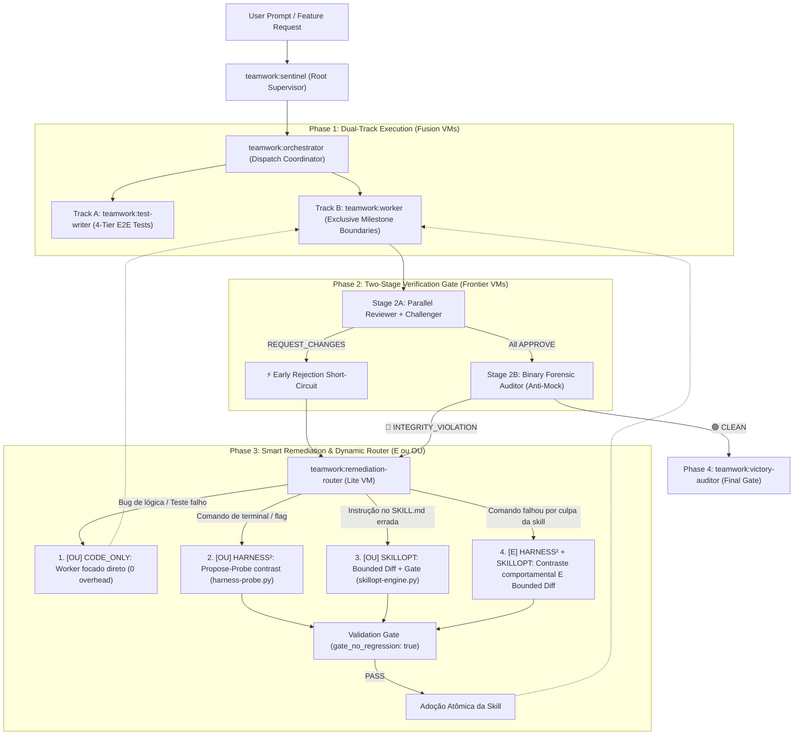

# Teamwork + Harness² + SkillOpt: Autonomous Multi-Agent Engineering & Self-Evolution System

[]()
[]()
[]()
[](LICENSE)

An enterprise-grade multi-agent engineering plugin for **Devin CLI, Devin Cloud, Claude Code, and Antigravity 2.0**.
It fuses:
1. **Hierarchical Multi-Agent Orchestration & Adversarial Verification Gate** ([Teamwork Plugin](https://github.com/matheuslessing/team-work-plugin)).
2. **Behavioral Contrast & Recursive Harnessing** ([Google Research Harness²](https://github.com/google-research/harness2)).
3. **Text-Space Skill Optimization & Validation-Gated Anti-Regression** ([Microsoft Research SkillOpt](https://microsoft.github.io/SkillOpt/)).

---

## 🏛️ Architecture Overview



---

## 🚀 Key Features

* **Dual-Track Isolation**: Implementers never edit tests to make them pass; QA test writers never edit production logic.
* **Strict Role Separation**: Orchestrators are dispatch-only. Explorers, Reviewers, Challengers, and Forensic Auditors have write tools disabled in their profiles.
* **Continuous Self-Evolution**: When a skill instruction causes execution errors or fails the Gate, **Harness²** extracts the contrastive lesson and **SkillOpt** generates a surgical bounded diff tested against a strict validation gate.
* **Binary Anti-Cheat Gate**: The Forensic Auditor enforces a zero-tolerance policy against fake tests, local mock bypasses, or tautological assertions.
* **Unified Cross-Platform Compatibility**: Manifested as `plugin.json` for Antigravity 2.0 / CLI, while fully supporting Devin CLI, Devin Cloud, and Claude Code.

---

## 🛠️ CLI Utilities & Proof of Concept

### 1. Run the Self-Evolution POC
Simulate the full end-to-end loop (Skill defect -> Runtime failure -> Harness² contrast -> SkillOpt bounded diff -> Validation Gate PASS -> Atomic adoption):

```bash
python scripts/demo-poc.py
```

### 2. Run the Test Suite
Run unit, schema, and gate tests:

```bash
python -m unittest tests/test_integration.py -v
```

### 3. Validate Any Skill Against the Gate
```bash
python scripts/skillopt-engine.py validate --skill skills/team-run/SKILL.md
```

### 4. Propose & Adopt Bounded Diffs
```bash
# Preview bounded diff with gate check
python scripts/skillopt-engine.py propose \
  --skill skills/sample/SKILL.md \
  --target "old command" \
  --replacement "new command"

# Adopt onto disk with automatic backup (.bak)
python scripts/skillopt-engine.py adopt \
  --skill skills/sample/SKILL.md \
  --target "old command" \
  --replacement "new command"
```

---

## 📋 Slash Commands

| Command | Category | Description |
| :--- | :--- | :--- |
| `/team-craft` | Prompting | Interactive 9-step prompt engineering interview with automatic delegation. |
| `/team-run` | Pipeline | Full Dual-Track autonomous execution (`Sentinel -> Orchestrator -> Survey -> Dual-Track -> Gate -> Victory`). |
| `/team-quick` | Agile | Focused 1-Worker + Adversarial Gate verification loop. |
| `/team-gate` | Gate | 3-Agent verification gate (`reviewer` + `challenger` + `forensic-auditor`). |
| `/team-audit` | Gate | Zero-tolerance Binary Forensic Integrity Audit (`🟢 CLEAN` vs `🔴 INTEGRITY VIOLATION`). |
| `/skill-evolve` | Self-Evolution | Autonomous skill refinement via Harness² contrast extraction and SkillOpt bounded edits. |
| `/team-status` | Dashboard | Real-time mission and milestone status dashboard. |

---

## 👥 Subagent Profiles

| Profile | Capability & Boundary |
| :--- | :--- |
| `teamwork:sentinel` | Root supervisor managing original requirements and Victory Audit trigger. |
| `teamwork:orchestrator` | Dispatch coordinator. Never edits production code. |
| `teamwork:test-writer` | Track A QA engineer authoring 4-tier E2E tests and CLI runners. |
| `teamwork:worker` | Track B milestone engineer implementing features within exclusive write boundaries. |
| `teamwork:reviewer` | Adversarial code and requirements reviewer (`APPROVE` vs `REQUEST_CHANGES`). |
| `teamwork:challenger` | Boundary and stress condition hunter. |
| `teamwork:forensic-auditor` | Binary anti-cheat auditor. Holds absolute veto power. |
| `teamwork:skill-optimizer` | Self-healer running text-space bounded diffs and validation gates on skills. |
| `teamwork:victory-auditor` | Final independent pre-delivery auditor spawned by Sentinel. |

---

## 📄 License

MIT © Matheus Lessing
