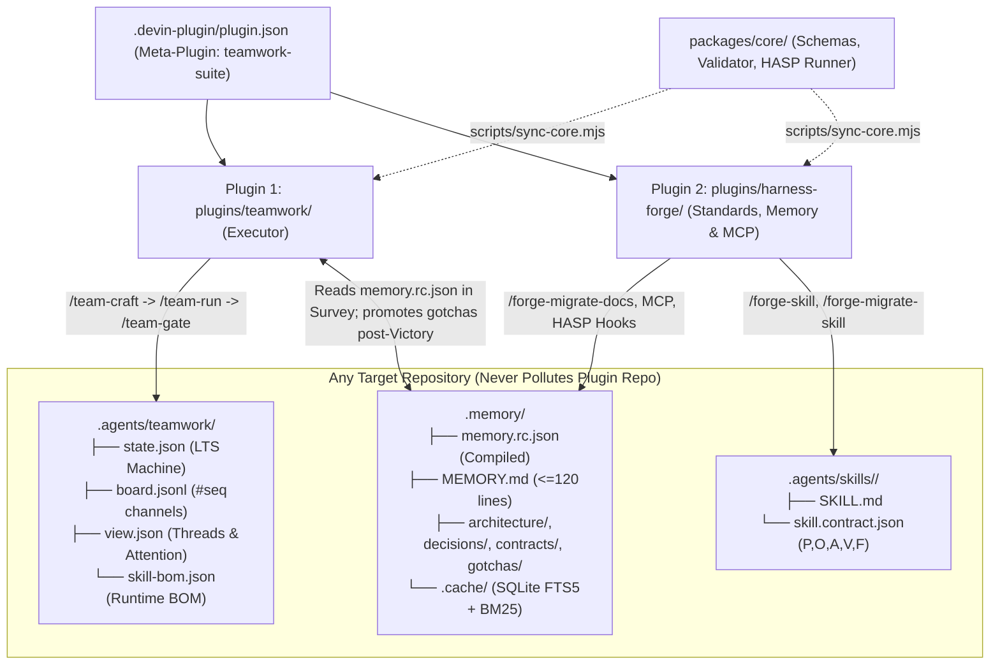

# Teamwork Suite (`teamwork` + `harness-forge`)

> **Multi-Plugin Engineering Suite** for **Devin CLI / Devin Cloud** and **Google Antigravity** bundling two decoupled, self-contained plugins:
> 1. **`plugins/teamwork/`** — Autonomous Dual-Track LTS execution harness (`Sentinel -> Orchestrator -> Explorers -> Contract Freeze -> Isolated Worktree Workers + E2E Test Track -> Adversarial & Forensic Gate -> Harness² Propose-Probe-Compose -> Victory Audit`).
> 2. **`plugins/harness-forge/`** — **SkillOps** 5-tuple skill factory & legacy migrator, **PMSP Project Memory** (`.memory/` + compiled `memory.rc.json`), **4-barrier standard enforcement**, embedded **`stdio` MCP server**, drift detector, and **`Skill-Use`** benchmark suite.

---

## Architecture Overview



### Repository Structure

```text
team-plugin/
├── .devin-plugin/plugin.json          # Root Meta-Plugin ("teamwork-suite")
├── packages/core/                     # Source-of-truth schemas, frontmatter, validators & HASP runner
├── scripts/sync-core.mjs              # Syncs packages/core/ into both sub-plugins
├── plugins/
│   ├── teamwork/                      # Plugin 1: Multi-Agent Dual-Track LTS Harness
│   │   ├── agents/                    # 9 agent profiles (read/audit roles have edit disabled)
│   │   ├── programs/                  # 5 HASP Program Functions (write-boundary, anti-cheat, facade-runner, handoff, loop-breaker)
│   │   ├── skills/                    # 12 standardized SkillOps skills (/team-*) + ecosystem-graph.json
│   │   ├── scripts/                   # teamwork-cli.mjs, hooks-engine.mjs, state-machine, board, stall-monitor, narrator-view, worktree, forensic-scanner
│   │   └── adapters/antigravity/      # Dual-target Antigravity manifest & hooks
│   └── harness-forge/                 # Plugin 2: SkillOps, Docs & Memory Factory + Embedded MCP
│       ├── .mcp.json                  # Embedded stdio MCP server (FORGE_MCP_MODE=full|validator-only)
│       ├── mcp-server/server.mjs      # Zero-dep JSON-RPC 2.0 MCP server with validated writes & auto-compile
│       ├── programs/                  # 3 HASP PFs (pf-rcjson-readonly, pf-memory-guard, pf-skill-contract-guard)
│       ├── skills/                    # 8 standardized SkillOps skills (/forge-*) + ecosystem-graph.json
│       ├── agents/                    # skill-migrator, doc-standardizer, memory-curator, harness-evolver
│       ├── templates/                 # Templates for SKILL.md, contracts, .pf.mjs, ADRs, architecture, contracts, gotchas
│       └── adapters/antigravity/      # Dual-target Antigravity manifest, mcp_config & hooks
└── tests/                             # 5-phase unit/E2E tests + evals/skill-use/ benchmark
```

---

## Installation

> **Requirements:** Node.js `>= 18` (zero external `npm` dependencies — runs out of the box), Git, and Python `>= 3.8` (only for Devin Cloud `workflow.py`).

### 1. Install Full Meta-Plugin Suite (Devin CLI & Devin Cloud)
```bash
devin plugins install matheuslessing/team-work-plugin
```
Or from a local clone (live editing):
```bash
git clone https://github.com/matheuslessing/team-work-plugin.git
devin plugins install --local ./team-work-plugin
```

### 2. Install Individual Sub-Plugins Independently
Each sub-plugin is 100% self-contained (`packages/core/` synced into `scripts/core/`):
```bash
devin plugins install --local ./plugins/teamwork
devin plugins install --local ./plugins/harness-forge
```

### 3. Google Antigravity Setup (Dual-Target)
Copy or symlink `plugins/teamwork/adapters/antigravity/*` and `plugins/harness-forge/adapters/antigravity/*` into the root of each plugin copy (or mount via Antigravity plugin discovery under `~/.gemini/config/plugins/`). Hooks automatically emit Antigravity's native contract (`decision: "allow"|"deny"`, `overwrite`, `injectSteps`, and `Stop` loop protection via `continuationActive`).

---

## How to Use Plugin 1: `teamwork` (Multi-Agent Execution Harness)

### Day-to-Day Workflow: From Idea to Verified Delivery

1. **Craft Requirements & Route Complexity (`/team-craft`)**
   Start any non-trivial task with `/team-craft <your idea>`:
   - Walks through 9 structured steps in `.agents/teamwork/prompt_draft.md`.
   - Applies the **Complexity Router**:
     - **Tier S (trivial 1-file fix)**: handle directly with normal tests (zero multi-agent overhead).
     - **Tier M (contained bug/feature)**: launches `/team-quick`.
     - **Tier L (multi-module architecture)**: launches `/team-run`.
   - On approval, locks `.agents/teamwork/ORIGINAL_REQUEST.md` and initializes `state.json` + `view.json`.

2. **Survey Memory & Freeze Contracts (`/team-survey` -> `/team-contract-freeze`)**
   - Explorers (`authority_profile: read_only`, `edit` disabled) consult `.memory/memory.rc.json` and check drift first, then map the codebase into `<active_orchestrator>/PROJECT.md`.
   - `/team-contract-freeze` SHA-256 hashes `PROJECT.md § Interface Contracts` into `state.json` (`CONTRACT_FROZEN`) so Track A and Track B code against identical signatures.

3. **Dual-Track Execution in Isolated Worktrees (`/team-test-track` + `/team-worktree`)**
   - **Track A (`test-writer`)**: writes 4-tier opaque-box E2E tests (`Feature >= 5`, `Boundary >= 5`, `Combinatorial`, `Scenarios`), `TEST_INFRA.md`, dynamic test runner, and `TEST_READY.md`.
   - **Track B (`worker` milestones)**: each milestone runs in its own isolated Git Worktree (`teamwork-cli.mjs spawn worker_m1 worker --own "src/m1/**" --worktree`) guarded by `pf-write-boundary`.
   - Coordinate via **Swarm Board** (`/team-board`) using zero-copy `#seq` citations (`@reviewer check #4`).

4. **Verification Gate & *Harness²* Remediation (`/team-gate` + `/team-audit`)**
   - Parallel **Reviewer** + **Empirical Challenger** + **Binary Forensic Auditor** inspect code, stress edges, and verify test authenticity (`🟢 CLEAN` vs `🔴 INTEGRITY VIOLATION`).
   - If the Gate fails twice on the same defect, `workflow.py` triggers **Harness² Propose–Probe–Compose** ($k=2$ candidate branches probed empirically, then contrastively synthesized).
   - **Gate Safety**: `workflow.py` and the `Stop` hook refuse Victory Audit / merge / exit while `GATE_STATUS.md` reports `FAIL`.

5. **Merge, Victory Audit & Status (`/team-status`)**
   - Worktrees only merge (`worktree merge`) after `GATE_STATUS.md` passes.
   - Sentinel spawns `victory-auditor`, transitions `state.json` to `DONE`, and promotes verified `DEAD_ENDS.md` lessons into `.memory/gotchas/`.

### All `/team-*` Slash Commands

| Command | Role / Mode | What It Does |
| :--- | :--- | :--- |
| `/team-craft` | Phase 1 Interview | 9-step prompt crafting + Complexity Router (Tier S/M/L) -> `ORIGINAL_REQUEST.md`. |
| `/team-run` | Full LTS Pipeline | `Survey -> Contract Freeze -> Dual-Track Worktrees -> Gate -> Propose-Probe-Compose -> Victory Audit`. |
| `/team-quick` | Small Focused Team | 1 scoped Worker + parallel Reviewer & Forensic Auditor remediation loop. |
| `/team-survey` | Phase 0 Survey | Consults `.memory/` + runs read-only Explorers -> `PROJECT.md`. |
| `/team-contract-freeze` | Contract Lock | SHA-256 hashes `PROJECT.md § Interface Contracts` into `state.json` (`CONTRACT_FROZEN`). |
| `/team-test-track` | Track A QA | Launches `test-writer` for 4-tier E2E suite, dynamic runner, `TEST_INFRA.md` & `TEST_READY.md`. |
| `/team-worktree` | Git Isolation | `create`, `status`, `diff`, Gate-enforced `merge`, and `prune` for parallel workers. |
| `/team-board` | Swarm Board | Append-only `board.jsonl` channels, `@mentions`, `#seq` refs, and `stall-check`. |
| `/team-gate` | 3-Agent Gate | Parallel `reviewer` + `challenger` + `forensic-auditor` -> `GATE_STATUS.md`. |
| `/team-audit` | Forensic Veto | Standalone anti-cheat scan (`scan-integrity --strict`) + 4-phase test/runner audit. |
| `/team-status` | Live Dashboard | Renders outcome `threads`, `attention` queue, `state.json` & `skill-bom.json` from `view.json`. |
| `/team-cloud-workflow` | Devin Cloud 100% | Executes `.agents/teamwork/workflow.py` (or Managed Devins fallback) with 30m `watch_dog`. |

### Agent Authority Profiles (Enforced by HASP `PreToolUse`)

| Agents | Authority Profile | `edit` Tool | Enforced Write Boundary |
| :--- | :--- | :---: | :--- |
| `explorer`, `reviewer`, `challenger` | `read_only` | Disabled | `.agents/teamwork/<agent_id>/**` only (shell mutations blocked) |
| `forensic-auditor`, `victory-auditor` | `audit_only` | Disabled | `.agents/teamwork/<agent_id>/**` only (binary veto) |
| `sentinel`, `orchestrator` | `dispatch_only` | Enabled | `.agents/teamwork/**` only (production/test edits blocked) |
| `test-writer` | `test_writer` | Enabled | `TEST_INFRA.md`, `TEST_READY.md`, `tests/**`, `run_tests.*` |
| `worker` | `scoped_worker` | Enabled | Exclusive `Own exclusively:` globs + worktree + agent dir |

---

## How to Use Plugin 2: `harness-forge` (Skills, Docs, Memory & MCP)

### Multi-Repository Scoping (Your Files Stay in Your Target Project)
`harness-forge` never writes project memory or project skills inside the plugin repository. Every CLI tool, hook, and MCP call resolves the target project dynamically (`project_dir` / `--workdir` / `DEVIN_PROJECT_DIR` / `cwd`):

* **`--scope project`** *(default)*: writes `<target-repo>/.memory/` and `<target-repo>/.agents/skills/`.
* **`--scope global`**: writes `~/.devin/skills/` for personal cross-repo skills.
* **`--scope plugin --target <dir>`**: writes `<dir>/skills/` when authoring or migrating skills into another plugin repository.
* **Separate Documentation Repo**: set `FORGE_MEMORY_ROOT` or add `.forge.json` (`{"memoryRoot": "../docs-repo/.memory"}`) at the project root.

### Workflow A — Standardize Existing Documentation into `.memory/`
Open any existing project repository and run:
1. **`/forge-memory init`** — creates `.memory/{architecture,decisions,contracts,gotchas,skills-learned,.cache}/` and updates `.gitignore`.
2. **`/forge-migrate-docs`** — reads existing `README.md`, `docs/`, wikis, and real source code; creates validated notes with verified `source_refs` (`path` + `symbols`) and compiles `memory.rc.json` + `MEMORY.md` (`<= 120` lines).
3. **`/forge-drift`** — detects whenever referenced source files or symbols change on disk (`stale: true` + `drift_reasons`) so agents never rely on outdated docs.
4. **`/forge-validate`** — runs strict schema + `memory.rc.json` index sync checks (and optionally `install-git-hook` for pre-commit protection).

### Workflow B — Create or Migrate Legacy Skills to SkillOps + HASP
1. **Migrate an existing skill (`/forge-migrate-skill <path>`)**:
   - Inspects legacy `SKILL.md` / markdown playbooks with `forge-cli.mjs skill analyze-legacy`.
   - Splits oversized content (`> 220` lines) into `references/` for **Progressive Disclosure**.
   - Generates typed `skill.contract.json` (`P_preconditions`, `O_operation`, `A_artifacts`, `V_validators`, `F_failure_modes`, `ecosystem_edges`) and optional HASP `.pf.mjs` guards.
2. **Create a new skill (`/forge-skill <name>`)**:
   - Scaffolds compliant `SKILL.md` + `skill.contract.json` in `project`, `global`, or `plugin` scope.
3. **Audit & Evolve (`/forge-skillops` + `/forge-evolve`)**:
   - Builds `ecosystem-graph.json` (detects overlaps, broken edges, missing HASP validators at zero LLM cost).
   - Evaluates skills with `Skill-Use` (`Trigger × Compliance × Boundary`).

### All `/forge-*` Slash Commands

| Command | Purpose |
| :--- | :--- |
| `/forge-skill` | Scaffold and validate a new skill (`SKILL.md` + `skill.contract.json`) in `project`, `global`, or `plugin` scope. |
| `/forge-migrate-skill` | Analyze & upgrade any legacy `SKILL.md` or playbook to SkillOps 5-tuple + HASP + Progressive Disclosure. |
| `/forge-memory` | Initialize `.memory/`, search (`BM25` / `SQLite FTS5`), read sections surgically, record ADRs, and promote gotchas. |
| `/forge-migrate-docs` | Standardize existing `docs/`/`README.md` or map codebases into `.memory/` with disk-verified `source_refs`. |
| `/forge-validate` | Zero-LLM strict compliance validator for `.memory/`, `memory.rc.json` sync, and SkillOps contracts. |
| `/forge-drift` | Compute SHA-256 & symbol drift across `source_refs` and mark/cure `stale` entries. |
| `/forge-skillops` | Build `ecosystem-graph.json`, run library-time `audit --strict`, and inspect skill telemetry. |
| `/forge-evolve` | Post-Victory *Harness²* + *Voyager* recursion gated by `eval-skills --min-score 0.90`. |

---

## Project Memory (PMSP), 4 Enforcement Barriers & Embedded MCP

### How Standard Compliance Is Guaranteed (Zero Prompt-Hope)
1. **Barrier 1 — Transactional MCP Writes (`mcp-server/server.mjs`)**: `memory_upsert` and `memory_record_adr` validate schemas, verify every `source_ref.path` and symbol exists on disk, compute `sha256_prefix` + line ranges + `token_estimate`, write atomically, and recompile `memory.rc.json` in one transaction.
2. **Barrier 2 — HASP `PreToolUse` & `PostToolUse` Hooks**:
   - `pf-rcjson-readonly` **blocks** manual edits to `memory.rc.json`, `MEMORY.md`, and `.memory/.cache/`.
   - `pf-memory-guard` validates direct `.memory/**/*.md` writes and auto-recompiles `memory.rc.json`.
   - `pf-skill-contract-guard` checks every `SKILL.md` / `skill.contract.json` edit immediately.
3. **Barrier 3 — Blocking `Stop` Hook & Git Hook**: refuses turn exit if `.memory/` is out of sync; `forge-cli.mjs install-git-hook` installs a `pre-commit` check for manual human edits.
4. **Barrier 4 — Code-to-Memory Drift (`memory drift`)**: flags `stale: true` whenever source files diverge.

### Embedded MCP Modes (Standalone vs. Enterprise `rcjson` MCP Coexistence)

Configured in `plugins/harness-forge/.mcp.json` (Devin) or `adapters/antigravity/mcp_config.json` (Antigravity):

| Mode (`FORGE_MCP_MODE`) | Exposed Tools | When to Use |
| :--- | :--- | :--- |
| **`full`** *(default)* | All 12 tools: `memory_index`, `memory_search`, `memory_read`, `memory_drift`, `memory_upsert`, `memory_record_adr`, `memory_retire`, `memory_rebuild_index`, `skill_index`, `skill_graph`, `skill_validate`, `skill_scaffold` | Standalone / personal / new projects using our embedded MCP for both read and write. |
| **`validator-only`** | 7 governance/write tools (`memory_drift`, `memory_upsert`, `memory_record_adr`, `memory_retire`, `memory_rebuild_index`, `skill_validate`, `skill_scaffold`) | **Enterprise coexistence**: pair with your company's existing read-only `rcjson` MCP (`memory.rc.json` + `.md` layout stays 100% compatible and protected by Barriers 2–4). |

```json
{
  "mcpServers": {
    "harness-forge-memory": {
      "type": "stdio",
      "command": "node",
      "args": ["${PLUGIN_ROOT}/mcp-server/server.mjs"],
      "env": {
        "FORGE_MCP_MODE": "validator-only"
      }
    }
  }
}
```

---

## CLI Reference & Verification Suite

Run all checks from the repository root (PowerShell / Bash):

```bash
# 1. Verify packages/core is synced into both sub-plugins
node scripts/sync-core.mjs --check

# 2. Run the full 5-phase Node.js test suite (LTS state, HASP, Board, Worktrees, Live stdio MCP, Dogfooding & Evals)
node --test tests/phase1-core-state.test.mjs tests/phase2-hasp-forensic.test.mjs tests/phase3-swarm-worktree.test.mjs tests/phase4-memory-mcp.test.mjs tests/phase5-dogfood-skillops-evals.test.mjs

# 3. Audit all 20 skills across both plugins strictly
node plugins/harness-forge/scripts/forge-cli.mjs skillops audit --skills-dir plugins/teamwork/skills --strict
node plugins/harness-forge/scripts/forge-cli.mjs skillops audit --skills-dir plugins/harness-forge/skills --strict

# 4. Run Skill-Use benchmark (Trigger x Compliance x Boundary)
node plugins/harness-forge/scripts/forge-cli.mjs eval-skills --suite tests/evals/skill-use

# 5. Run Forensic Integrity Scanner across repo tests
node plugins/teamwork/scripts/teamwork-cli.mjs scan-integrity --workdir . --strict

# 6. Verify Devin Cloud Dynamic Workflow script
python -B plugins/teamwork/skills/team-cloud-workflow/workflow.py --check
```

---

## Research Foundations Implemented

* *Agent Harness for Large Language Model Agents: A Survey* (Meng et al., 2026) — Formal 6-component LTS harness $\mathcal{H} = (E, T, C, S, L, V)$.
* *The Agent Loop: A Survey of Control Strategies, Skills, and Harnesses* (Lee & Park, 2026) — Complexity Router, explicit budget caps, and external verification gates.
* *Harnessing Agent Skills* (arXiv:2606.20631) — 4-layer architecture, *Skill–Execution Authority Separation*, *Runtime Skill-BOM*, and *Skill Scope Cascade*.
* *HASP: Harnessing LLM Agents with Skill Programs* (arXiv:2605.17734) — Executable `should_activate` + `intervene` Program Functions.
* *SkillOps* (arXiv:2605.13716) — Typed 5-tuple $(P, O, A, V, F)$ skill contracts & library-time ecosystem graph maintenance.
* *Skill-Use* (arXiv:2608.04828) — Gated `Trigger × Compliance × Boundary` benchmark under progressive disclosure.
* *Harness²* (Google Cloud AI & Northwestern, 2026) — Task-level `Propose–Probe–Compose` & cross-task recursive evolution.
* *Voyager* (2023) — Verified procedural skill promotion.
